  
    
  
    
  
    
  
    
  
    
  
    
  
    
  
    
  <a href="mailto:geral@worevi.com">geral@worevi.com</a> · <a href="tel:+351910861499">+351 910 861 499</a> · <a href="https://worevi.com">worevi.com</a> · <a href="https://piscobrilho.com">piscobrilho.com</a>

